<div align="center">


# Kodiak Cleaner

**Not a Crap Cleaner. A Cleaner App, Built Around What Matters.**

A small, honest cleaner for Windows. No telemetry, no ads, no upsells, no bundled offers and no background services.

[](https://github.com/ttabakagroup/kodiakcleaner/releases)
[](LICENSE)
[-2f6f9f)](#system-requirements)
[](https://dotnet.microsoft.com/)
[](#privacy)

[**Website**](https://www.kodiakcleaner.app/) ·
[**Download**](https://github.com/ttabakagroup/kodiakcleaner/releases) ·
[Features](#features) ·
[How to Use](#how-to-use) ·
[Screenshots](#screenshots) ·
[Privacy](#privacy) ·
[FAQ](#faq) ·
[Feedback](#feedback-and-support)

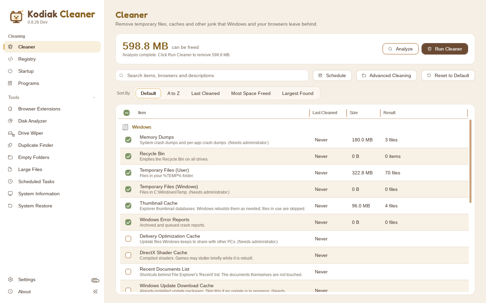

</div>

> [!WARNING]
> **Beta software: use at your own risk.** Kodiak Cleaner is still in development, and more testing is needed before every feature can be confirmed to work as intended. It deletes things by design, so check what's selected before you clean and keep your own backups of anything important.

## Contents

- [Why Kodiak Cleaner](#why-kodiak-cleaner)
- [Highlights](#highlights)
- [Download](#download)
- [Install, Update and Uninstall](#install-update-and-uninstall)
- [How to Use](#how-to-use)
- [Command Line](#command-line)
- [Features](#features)
- [Screenshots](#screenshots)
- [Privacy](#privacy)
- [Built-In Safety](#built-in-safety)
- [FAQ](#faq)
- [Feedback and Support](#feedback-and-support)
- [Building From Source](#building-from-source)
- [License](#license)

## Why Kodiak Cleaner

For more than two decades, Ted Tabaka used the same cleaning app. Then an upgrade made routine tasks harder and familiar
features harder to find, which inspired Kodiak Cleaner: an open source app focused on simplicity, privacy and practical functionality.

The idea is simple: open Kodiak Cleaner, choose what you want to clean, get it done, and get on with your day.
It is private first, local first, and built with security as a top priority. Read the full story in
[Why It Was Made](source/why-it-was-made.md).

## Highlights

- **Backups before changes.** Every registry fix, startup removal and program entry change is backed up first, and most removals go to the Recycle Bin.
- **Fast and familiar.** Analyze, review, clean. No waiting for a busy interface or hunting for moved buttons.
- **Free and open source.** Every feature is free, under the [MIT License](LICENSE).
- **Installed or portable.** Use the MSI installer or run the portable version from any folder, even a USB drive.
- **Local first.** Settings live in a plain `KodiakCleaner.ini` file next to the program; backups, the activity log and exported reports go in `Documents\Kodiak Cleaner`. Nothing goes in AppData.
- **No ads, no tracking.** No telemetry, analytics, crash reports or upsells. The only time it goes online is to check for updates, and only when you ask.
- **Your look.** Four color schemes (Honey free, Classic, Glacier and Lagoon for supporters), seven accent colors or your Windows accent (free for everyone, adjusted so text stays readable), light or dark mode.

## Download

Get the newest build from the **[Releases page](https://github.com/ttabakagroup/kodiakcleaner/releases)**. Each release has two downloads:

| Download | File | Best for |
|----------|------|----------|
| **Installer** | `KodiakCleaner-<Channel>-Setup.msi`, for example `KodiakCleaner-Dev-Setup.msi` | Most people. Adds Start menu shortcuts, installs updates for you, and can skip the administrator prompt. |
| **Portable** | `KodiakCleaner-<Channel>-Portable.zip`, for example `KodiakCleaner-Dev-Portable.zip` | Running without installing, from any folder or a USB drive. Leaves no trace outside its own folder. |

Both are a single self-contained program, so there's nothing else to install. The file names stay the same every release (the version is in the release name), and the Portable ZIP has a `Docs` folder with the changelog, read me, license, privacy policy, Terms of Use and links to the website and the newest download, as plain text. The installer puts the same folder in `Program Files\Kodiak Cleaner\Docs`.

Copies of the newest Windows and Linux downloads are also kept in the [releases](releases/) folder of this repository. Older versions are on the Releases page.

### System Requirements

- Windows 10 or Windows 11, 64-bit (x64)
- About 100 MB of free disk space
- Administrator rights only for system-wide items (Kodiak Cleaner asks when it needs them)

### Release Channels

| Channel | Versions | Shown as | Notes |
|---------|----------|----------|-------|
| Dev | 0.8.x | 0.8.30 Dev | Early builds, marked as pre-releases. Current channel. |
| Beta | 0.9.x | 0.9.0 Beta | Feature-complete builds for wider testing, marked as pre-releases. |
| Stable | 1.x | 1.0.0 | Full releases. |

Every channel installs to `Program Files\Kodiak Cleaner`, and installing one replaces another. In-app updates stay on their own channel.

## Install, Update and Uninstall

### Install

1. Download `KodiakCleaner-Dev-Setup.msi` from the [Releases page](https://github.com/ttabakagroup/kodiakcleaner/releases).
2. Double-click the `.msi` and follow the steps.

The installer isn't code-signed yet, so Windows SmartScreen may warn you the first time. Click **More info**, then **Run anyway**.

**Portable:** extract the **Portable** ZIP to any folder and run `KodiakCleaner.exe`.

### Update

- **Installed:** click **Check for Updates** on the **About** page or **Check Now** under **Settings > Updates**, or turn on Check for Updates Automatically there (it tells you when a new version is out) and, if you like, Download and Install Updates Automatically. You can also run a newer MSI over the old one. Your settings and backups are kept either way.
- **Portable:** replace `KodiakCleaner.exe` and the `Docs` folder with the new ones, and keep `KodiakCleaner.ini` and the `Backups` and `Logs` folders next to it.

To be extra safe, use **Settings > Application > Back Up Settings** before updating.

After an update, What's New shows everything that changed since your previous version. The full history is in [CHANGELOG.md](source/CHANGELOG.md).

### Uninstall

Uninstall Kodiak Cleaner from **Windows Settings > Apps**. It removes the program, its settings, its scheduled tasks and its other Windows entries, then asks whether to delete your backups, logs and reports in `Documents\Kodiak Cleaner` too. Keep them if you might still want to undo a registry fix. A silent `msiexec /x ... /qn` keeps them unless you add `DELETEUSERDATA=1`.

For the portable version, turn off **Clean When Windows Starts**, the Recycle Bin menu and any schedules, then delete its folder.

## How to Use

The first time Kodiak Cleaner starts, **Getting Started** walks you through the basics.

<p align="center">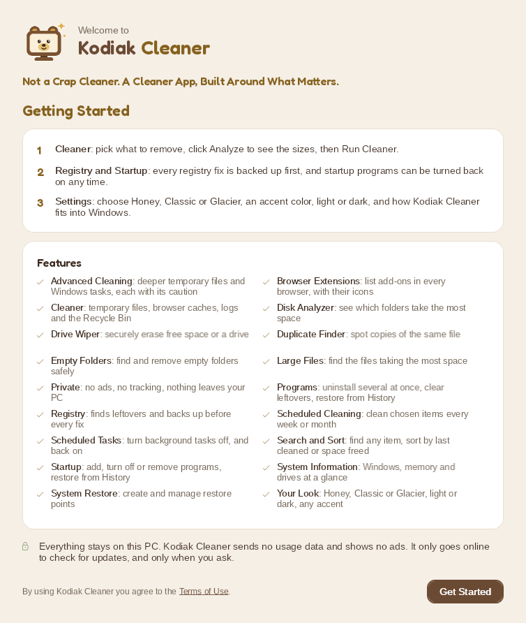</p>

### Clean Your PC

1. Open **Cleaner** in the sidebar.
2. Tick what you want to clean. **Reset to Default** brings back the safe basics.
3. Click **Analyze** to see how much space each item would free. Nothing is deleted yet.
4. Click **Run Cleaner** to clean.

Tips:
- Use the search box to find any item, and **Sort By** to order the list (Default, A to Z, Last Cleaned, Most Space Freed or Largest Found).
- Browsers are skipped while they're open, so close them first.
- Some items need administrator rights. Click **Restart as Administrator** on the banner, or turn on **Always Start as Administrator** under **Settings > Advanced**.

### Fix Registry Problems

1. Open **Registry** and click **Scan for Issues**.
2. Review the list, untick anything you want to keep, then click **Fix Selected**.

Every fix is saved to a `.reg` backup first. To undo a fix, open `Backups\Registry` (**Settings > Registry > Open Folder**) and double-click the backup.

### Speed Up Start-Up

1. Open **Startup** to see the programs that start when you sign in.
2. Turn a program off with its switch, or tick several (or Ctrl-click or Shift-click to highlight them) and click **Disable Selected**.

Turning a program off works exactly like Task Manager's Disable and can be undone at any time. **History** lists every entry Kodiak Cleaner has seen, so removed ones can be restored.

When a program adds itself to startup, Kodiak Cleaner tells you the next time it starts (or within 10 minutes while it's open or in the tray). The pop-up lists the new entries so you can **Keep**, **Disable** or **Delete** each one. Turn it off in **Settings > General > Tell Me About New Startup Programs**.

### Uninstall Programs

1. Open **Programs** and tick one or more programs, or Ctrl-click or Shift-click to highlight several and right-click them.
2. Click **Uninstall**. Kodiak Cleaner backs up the program's registry entries, runs its own uninstaller, then offers to remove the folders, shortcuts and registry keys it left behind.

Kodiak Cleaner never uninstalls itself or deletes its own entry. Remove it from **Control Panel > Programs and Features** (or **Settings > Apps**), as described under [Uninstall](#uninstall).

The **Product Code** column shows each Windows Installer program's GUID. Right-click a program and choose **Copy Product Code**, or **Copy Uninstall Command** for a ready-to-run `msiexec /x {GUID} /qn`.

### Schedule Cleanings

1. On the **Cleaner** page, click **Schedule**, then **New Schedule**.
2. Give it a name, pick the days and time, tick the items, and click **Save Schedule**.

Windows Task Scheduler starts Kodiak Cleaner at that time; it cleans without opening a window and then closes, so nothing runs in the background.

### Command Line

Scripts and system administrators can run Kodiak Cleaner without a window:

| Command | What it does |
|---|---|
| `KodiakCleaner.exe /clean` | Cleans the items ticked on the Cleaner page. Add `/items:ID,ID` to clean just those items. |
| `KodiakCleaner.exe /list-items` | Lists every Cleaner item ID, marking the ticked ones. |
| `KodiakCleaner.exe /registry` | Scans the registry and fixes what it finds, backing up every fix to a `.reg` file first. Add `/scan-only` to change nothing, or `/categories:"Fonts,Help Files"` for some checks only. |
| `KodiakCleaner.exe /uninstall:"Program Name"` | Backs up the program's registry entries and runs its uninstaller. A product code works too: `/uninstall:{GUID}`. Add `/quiet` for a silent uninstall (`msiexec /x {GUID} /qn`, or the program's own quiet uninstall). |
| `KodiakCleaner.exe /list-programs` | Lists installed programs with their version and product code. |
| `KodiakCleaner.exe /help` | Shows these switches. |

Exit codes: `0` done, `1` done with some failures, `2` wrong switch, nothing found or Kodiak Cleaner itself, `3` the uninstall didn't finish. Items with a caution never run from the command line, and leftovers after an uninstall are only removed from the Programs page. Run it as administrator for anything shared by all users. Kodiak Cleaner is a window program, so Command Prompt doesn't wait for it: use `start /wait KodiakCleaner.exe /clean` and then `%ERRORLEVEL%`, or in PowerShell `Start-Process KodiakCleaner.exe -ArgumentList '/clean' -Wait -PassThru`. Everything is also written to the activity log.

## Features

### Cleaning

| Page | What it does |
|------|--------------|
| **Advanced Cleaning** | Deeper items, shown only after a warning: more temp folders and caches, old Windows logs, Prefetch, the print queue, and Windows tasks run with Windows' own tools (DNS cache, clipboard, Run history, Windows Update cleanup, event logs, older shadow copies, hibernation file, CompactOS). Never ticked by default. Risky items carry a caution, ask before they're ticked and never run on a schedule. |
| **Cleaner** | Windows temp files, Recycle Bin, thumbnail cache, error reports, crash dumps, DirectX shader cache, Windows Update and Delivery Optimization caches, and the recent documents list. Browser cache, history and cookies for Ablaze Floorp, Brave, Google Chrome, Helium, Microsoft Edge, Mozilla Firefox, Mullvad Browser, Opera, Opera GX, Vivaldi and Waterfox, each shown with the browser's own icon. Search, Sort By, a Last Cleaned column, and Reset to Default. |
| **Programs** | Searchable list of installed programs with their icons. Uninstall several at once (one at a time, with leftover removal), Repair, Rename and Delete Entry. A Product Code column with Copy Product Code and Copy Uninstall Command for administrators. History records everything removed or changed and can restore it. |
| **Registry** | Finds entries that point at files or programs that no longer exist, across 15 checks: ActiveX and class issues, applications, application paths, fonts, help files, installer, missing shared DLLs, MUI cache, obsolete software, run at startup, sound events, Start menu ordering, type libraries, unused file extensions and Windows services. Fix all, a selection, or Ctrl-click or Shift-click to highlight several and right-click them. Every fix is backed up first. |
| **Scheduled Cleaning** | Named cleanings that run on chosen weekdays or a day of the month, through Windows Task Scheduler. A cleaning missed while the PC was off runs at the next chance. |
| **Startup** | Programs that start when you sign in (per user and all users), each with its icon. Turn them off or on one at a time or in a batch, add a program to your Startup folder, remove entries (backed up first), and restore removed ones from History. A pop-up tells you when a program adds itself to startup. |

<table>
  <tr>
    <td>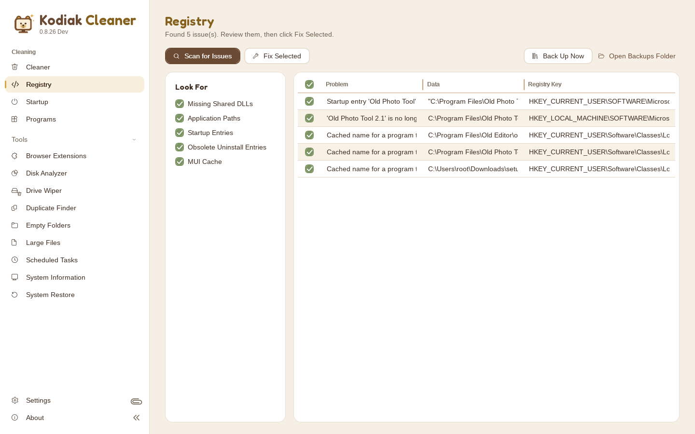</td>
    <td>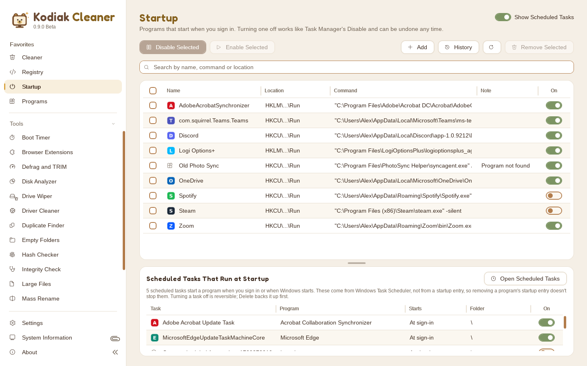</td>
  </tr>
  <tr>
    <td align="center"><b>Registry</b></td>
    <td align="center"><b>Startup</b></td>
  </tr>
  <tr>
    <td>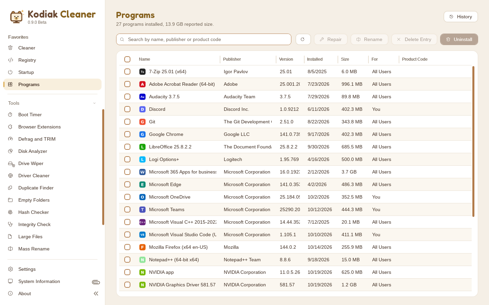</td>
    <td>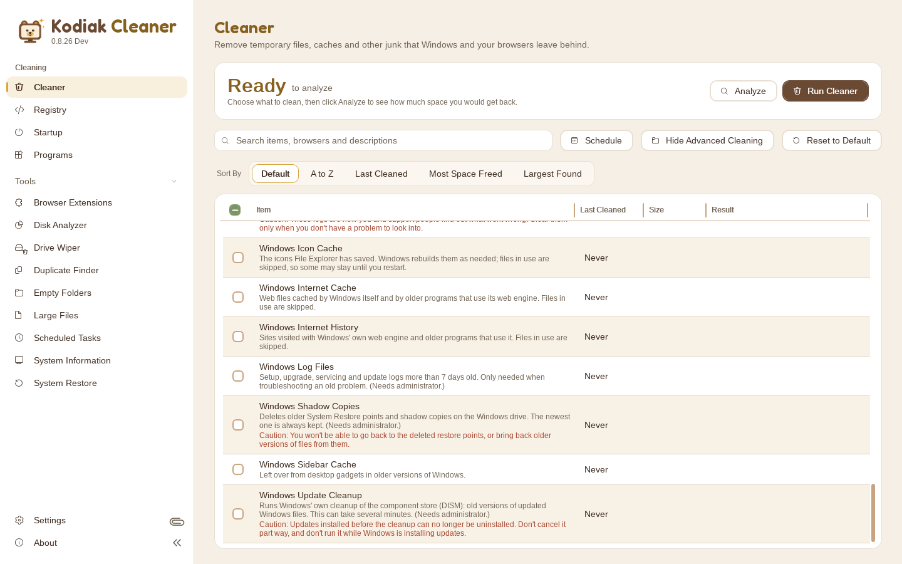</td>
  </tr>
  <tr>
    <td align="center"><b>Programs</b></td>
    <td align="center"><b>Advanced Cleaning</b></td>
  </tr>
</table>

### Tools

| Tool | What it does |
| **Boot Timer** | Restarts the PC and times it: shutting down, Windows starting, and the desktop settling after sign-in. Then lists what slowed the start, slowest first (startup programs with their processor time and disk use, plus drivers, services and devices Windows itself found slow when run as administrator), with Show in Startup and Turn Off at Startup. Keeps the last 10 timings as a chart. |
|------|--------------|
| **Browser Extensions** | Lists the extensions in Ablaze Floorp, Brave, Google Chrome, Helium, Microsoft Edge, Mozilla Firefox, Mullvad Browser and Vivaldi, with their icons, versions and on or off state. Right-click to turn one off or on, or remove it, or use its On switch. Chrome, Edge and Brave are changed through their own extension policies (needs administrator); Firefox-based add-ons can be removed while the browser is closed |
| **Defrag and TRIM** | Lists your drives with their type (Hard Drive, SSD, NVMe SSD, Flash Drive) and gives each the right step with Windows' own optimizer: hard drives are defragmented (Analyze shows how fragmented they are first), SSDs are trimmed, flash drives are left alone. Tick one drive or all of them. Needs administrator rights. |
| **Disk Analyzer** | Pick one drive, several, all of them or a folder, then explore a map of what's using the space, colored by kind of file. Click any folder to look inside, see which kinds of files fill it, list the largest files, and send a file to the Recycle Bin. Run as administrator, whole NTFS drives are read from the drive's file table in seconds. |
| **Driver Cleaner** | Removes an old AMD, Intel or NVIDIA graphics driver (or a Realtek audio driver) completely before a fresh install: its driver store packages (with Windows' own `pnputil`), leftover folders (to the Recycle Bin) and registry keys (backed up first). Makes a restore point and backs up each package first, can restart into Safe Mode and open itself there, can stop Windows Update from putting a driver back, then offers Restart or Shut Down (to swap the card) and links to the maker's own driver page. |
| **Drive Wiper** | Overwrites free space, or wipes whole drives (tick one or several). Wipe Type: Quick removes only the partition data, Thorough writes zeros over every sector, Secure uses DoD 5220.22-M (3 passes), DoD 5220.22-M ECE (7 passes) or 30 passes (the DoD pattern ten times; not a published standard), and the last pass is read back and checked. SSDs and NVMe drives get their own firmware erase (crypto or block erase, NIST SP 800-88 Purge) on Thorough and Secure. Every wipe removes all partitions and the MBR or GPT; the drive is then left uninitialized like a new one, or set up as GPT or MBR with NTFS, exFAT or FAT32. Three checks before anything starts: a summary, each drive's disk number, then the word ERASE. Refuses any disk that holds Windows, its start-up partition, the page file, Kodiak Cleaner, your user folder or programs. |
| **Duplicate Finder** | Finds files with identical contents (size, quick hash, then full SHA-256) in folders or on whole drives (one, several or all; Windows, program folders and AppData are skipped). Run as administrator, a whole NTFS drive is listed straight from its file table, which is much faster than opening every folder, and only files of the same size are ever hashed. In-Depth also finds files that are alike (edited copies, re-saved pictures, older drafts), ranked by how alike they are. Name Matching can also list files by similar names alone, leave out copy marks, version words, dates, numbers or your own words, and gather files by name patterns you type (for example `Invoice #.pdf`). Verify Hashes reads the files again and confirms each set by SHA-256. Removed copies go to the Recycle Bin, the last identical copy is never removed, and similar files are never ticked for you. |
| **Empty Folders** | Finds folders with nothing inside on whole drives (one, several or all) or in folders you pick, and moves the ones you choose to the Recycle Bin. Windows, program, AppData and hidden folders are never searched, and every account's personal folders are never offered |
| **Integrity Check** | Checks and repairs Windows and your drives with Windows' own tools, one card per check (A to Z): Drive Error History (drive and file system errors Windows logged in the last 30 days, explained in plain words), Drive File System (checks ticked drives while you work; Repair fixes them, the Windows drive at the next restart, with an optional Look for Bad Sectors), Drive Health (each drive's own report: failing or not, temperature, wear, uncorrected errors), Memory Test (opens Windows' Memory Diagnostic and shows its last result), Windows Component Store (check, and repair from Windows Update) and Windows System Files (check, and repair damaged or changed Windows files; if that fails it offers to repair the Component Store and try again). Check Everything runs every check without changing anything. Repairs ask first and can't be stopped halfway. Windows' messages show under Details and are saved in Reports\Integrity Check. Most checks need administrator rights. |
| **Large Files** | Lists the biggest files in a folder (50 MB and up, your choice) and moves the ones you pick to the Recycle Bin. Windows, program folders, and hidden or system files are skipped. |
| **Mass Rename** | Renames a set of files in a folder (and its subfolders, if you like) by a pattern you set: the old name, a counting number, the folder name, date created, modified or taken, parts of the old name, plus Find and Replace (with regular expressions), letter case, a new or tidied extension and tidy spaces. Every new name is shown next to the old one before anything changes, names Windows wouldn't accept or that two files would share are flagged and skipped, and Undo Last Rename puts the names back. Windows, program folders and AppData are never offered. |
| **Scheduled Tasks** | Lists the programs Windows runs on a schedule, each with the program it starts and its icon (click to see it in File Explorer), and turns them off or back on. Delete backs each task up first, Back Up saves tasks on request, and Restore puts deleted tasks back. Windows' own tasks are hidden unless you show them |
| **System Restore** | Lists, creates and removes restore points, and opens System Restore to roll back. The newest point can't be removed. Create Restore Point works even when Windows already made one that day, so you can make one right before a big install. The Point-in-Time Restore tab (Windows 11 24H2/25H2, June 2026 update or later) turns that feature on or off, sets how often Windows takes snapshots, how long it keeps them (72 hours at most) and how much space they may use, lists the snapshots, takes one now with Windows' own snapshot task, and restarts into Windows Recovery, where the restore itself happens. |

While a tool works you can open any other page: a small card in the bottom right corner shows what it's doing and how far along it is (click it to go back). Closing Kodiak Cleaner while a task is running asks first, with Keep Open as the default.

<p align="center">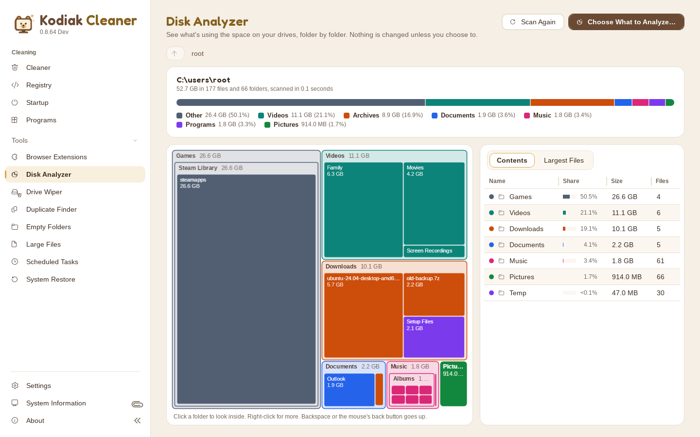</p>

### System Information

System Information sits at the bottom of the sidebar, between Settings and About. It is read-only, and nothing it reads leaves your PC. It reads in the background with a progress bar and a Cancel button, so you can use other pages while it works.

- **Summary**: Windows edition, version and build, up time, processor, memory, drives, and how Kodiak Cleaner is running.
- **Advanced**: drive models, serial numbers, health and connection; memory type, speed, slots and each module's maker, part and serial number; processor cores, threads, speeds and L1/L2/L3 cache; PC model and serial number, motherboard, BIOS, UEFI, Secure Boot and TPM; graphics memory, driver and resolution; each network adapter's MAC, IPv4 and IPv6 addresses, gateway, DNS and DHCP; audio devices; a few Windows settings (antivirus, firewall, power plan, page file, Remote Desktop, UAC and more); and temperatures where Windows shares them.
- **Export Report** saves both views as a Text document, a themed HTML page or a CSV spreadsheet (pick one from the dropdown; the choice is remembered) in the `Reports` folder beside `Backups` and `Logs`. Reports include serial numbers and network addresses, so share them only with people you trust.

Left out on purpose: the Windows product key, nearby Wi-Fi networks, and per-core and SMART tables. Memory timings such as CAS latency can't be read without installing a driver, so they aren't shown.

<p align="center">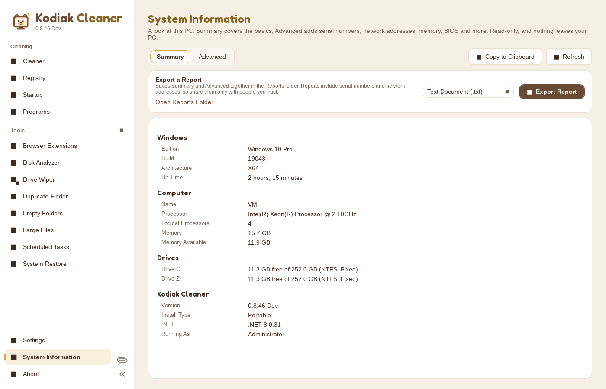</p>

### Settings and Personalization

Every setting is a switch and is saved straight away. Type in the search box above General to find a setting by name.

| Area | What's there |
|------|--------------|
| **Advanced** | Always start as administrator, and skip the User Account Control prompt (installed copies only). |
| **Appearance** | Honey, Classic, Glacier or Lagoon color scheme, an optional accent color, Match Device, Light or Dark, and an Animations switch. |
| **Cleaning** | Clean when Windows starts, ask before cleaning, and keep recent temp and Recycle Bin files from the last 24 hours. |
| **Contact & Feedback** | Send Feedback, Report a Bug, Request a Feature and Security, each opening the Contact Us form on the website in your browser with the topic picked. |
| **General** | What's New after updates, the beta notice, minimize or close to the system tray, the sidebar width and paperclip lock, the Recycle Bin menu and Jump List tasks. |
| **Protect** | Back Up Now saves the registry areas Kodiak Cleaner can change into one `.reg` file (the very large ones are backed up with each fix instead), with an optional prompt before each registry fix. Back up, open or reset the settings file. |
| **Updates** | Check Now (also on the About page as Check for Updates). Check for Updates Automatically (off by default) looks for a new version as often as you pick (On Startup, Every Hour, Every 4 Hours, Daily, Every 3 Days, Weekly, Twice a Month or Monthly) and tells you when one is out. Download and Install Updates Automatically (off by default) also downloads it and installs it when you close Kodiak Cleaner. |

The sidebar can be widened, locked with the paperclip, or collapsed to icons only.

<p align="center">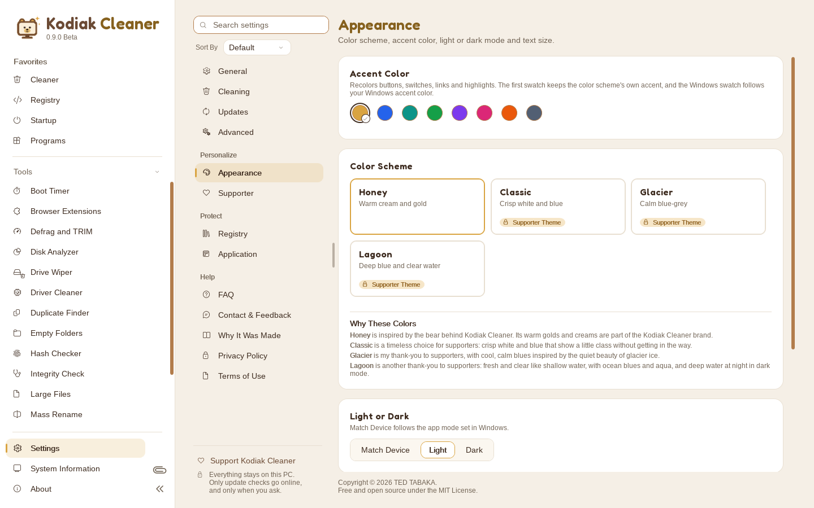</p>

## Screenshots

<table>
  <tr>
    <td></td>
    <td>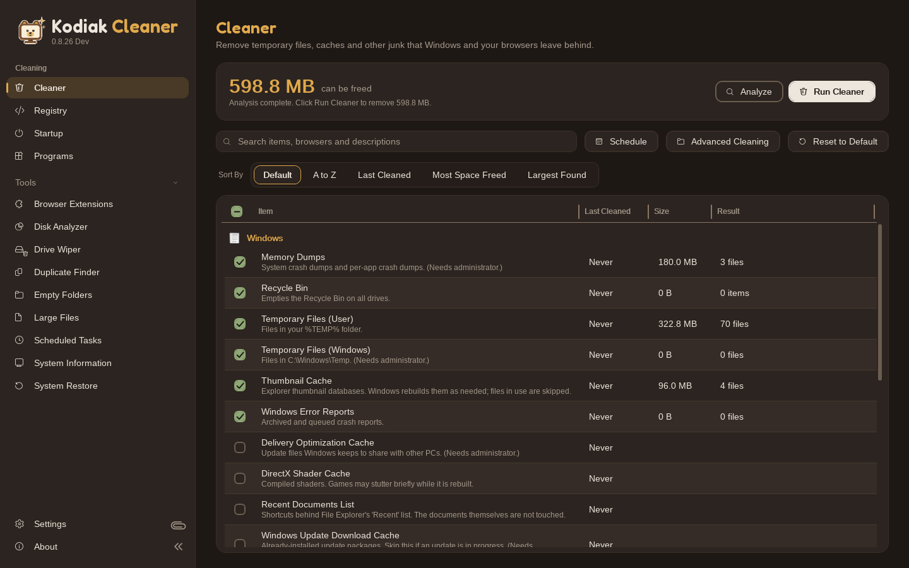</td>
  </tr>
  <tr>
    <td align="center"><b>Honey</b> (light)</td>
    <td align="center"><b>Honey</b> (dark)</td>
  </tr>
  <tr>
    <td>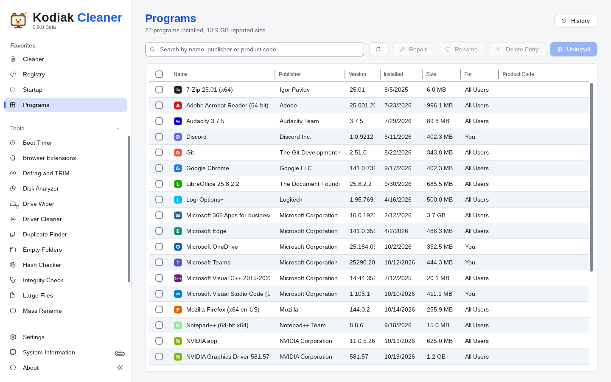</td>
    <td>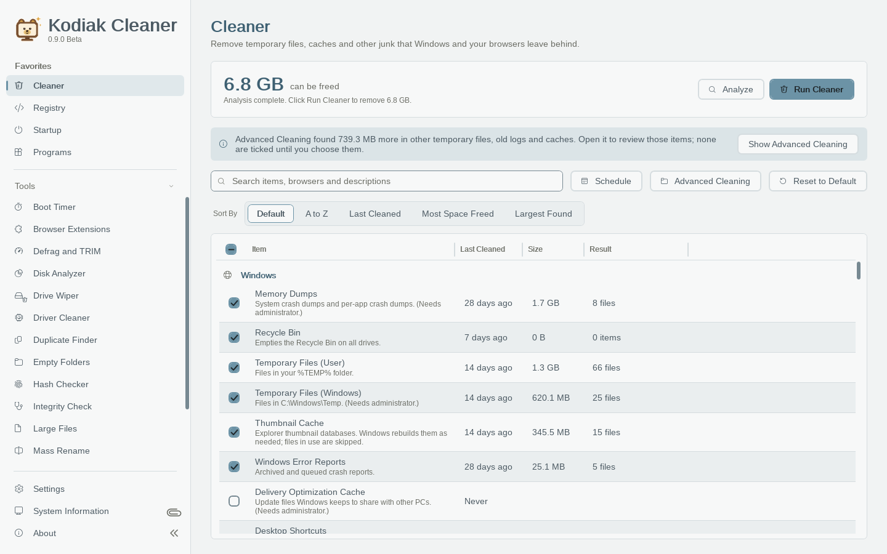</td>
  </tr>
  <tr>
    <td align="center"><b>Classic</b> (Supporter theme)</td>
    <td align="center"><b>Glacier</b> (Supporter theme)</td>
  </tr>
  <tr>
    <td>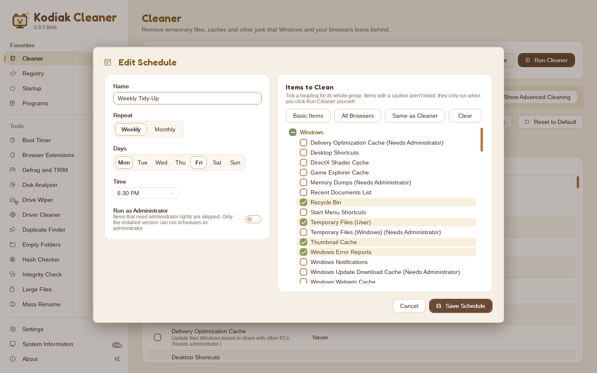</td>
    <td>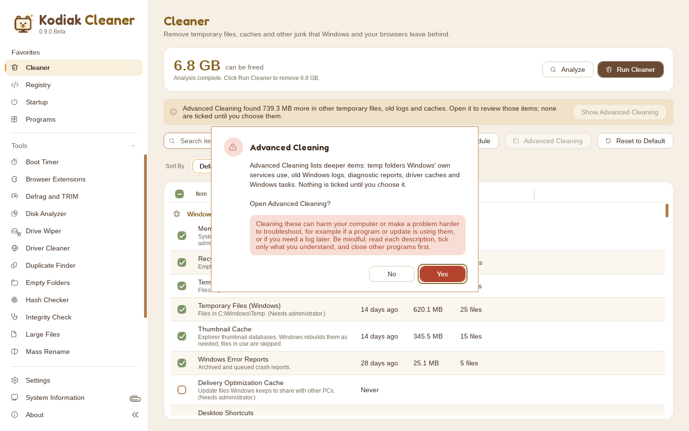</td>
  </tr>
  <tr>
    <td align="center"><b>Scheduled Cleaning</b></td>
    <td align="center"><b>Advanced Cleaning warning</b></td>
  </tr>
  <tr>
    <td>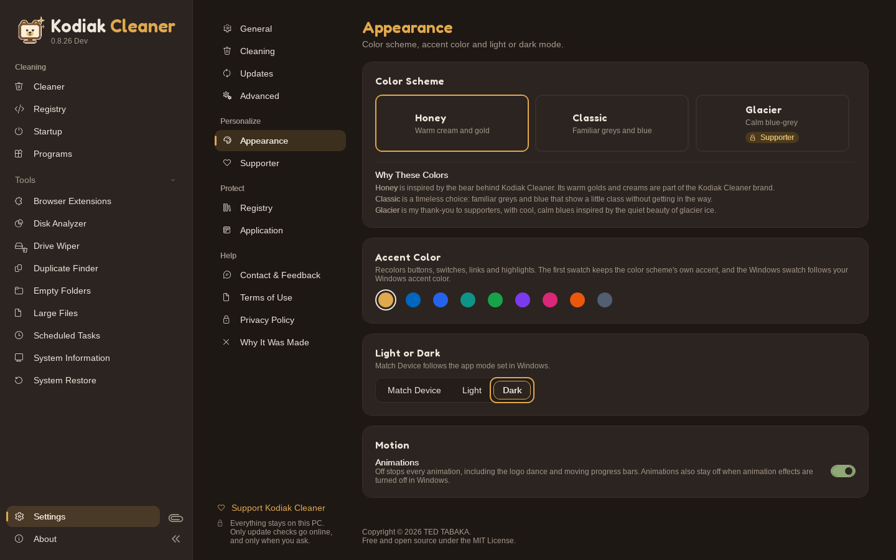</td>
    <td>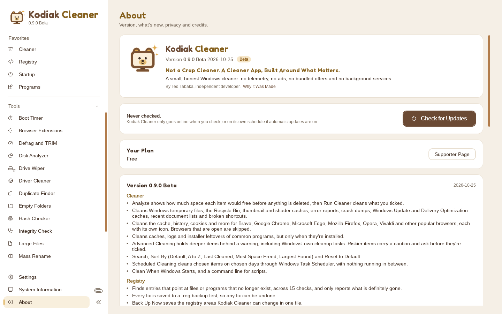</td>
  </tr>
  <tr>
    <td align="center"><b>Appearance</b> (dark)</td>
    <td align="center"><b>About</b></td>
  </tr>
</table>

## Privacy

Everything stays on your PC.

- **Feedback** opens the Contact Us form on the website in your browser. Nothing is sent until you press Send Message there.
- **No remote resources.** The Fredoka font is built in, and icons come from Windows' own icon font.
- **No telemetry**, analytics, crash reports, accounts or ads. Nothing is sent automatically, ever.
- **Settings, backups and logs** are plain files: `KodiakCleaner.ini` next to `KodiakCleaner.exe`, and the `Backups`, `Logs` and `Reports` folders in `Documents\Kodiak Cleaner` (beside the exe for the portable version). The activity log stays on your PC and can be turned off.
- **Updates are the only network use.** Kodiak Cleaner reads one small update file from its website, www.kodiakcleaner.app, only when you click **Check for Updates** on the About page or **Check Now** in Settings, or on the schedule you pick if you turn on Check for Updates Automatically (off by default; on startup, every hour up to monthly). The installer comes from the same website and is checked against the SHA-256 checksum in that file before it's installed.

Read the full [Privacy Policy](source/PRIVACY.md) and [Terms of Use](source/terms-of-use.md).

## Built-In Safety

- Browsers are skipped while they're open, and files in use are skipped.
- Cleaning folders are sanity-checked before anything is deleted.
- Kodiak Cleaner runs as a normal user and asks for administrator rights only for system-wide items.
- The registry scanner never reports files in the Windows folder, drivers, or services that start with Windows' core.
- Program changes, registry fixes and startup removals are backed up first, and can be restored from History or by double-clicking the `.reg` backup.
- Risky Advanced Cleaning items carry a caution, ask before they're ticked, and never run on a schedule.
- Symbolic links and junctions are never followed.
- The registry scanner only reports a file as missing when it's on a present, fixed local drive.

## FAQ

**Can Kodiak Cleaner break my PC?**
It's designed to be careful (see [Built-In Safety](#built-in-safety)), but it's beta software that deletes things by design. Use the default items if you're unsure, read each description before ticking, and keep your own backups.

**Does it run in the background?**
No. There's no service and nothing running unless you open it. Scheduled cleanings are started by Windows Task Scheduler and close when they're done.

**Is it really free?**
Yes, with every feature. If it helps you, an optional one-time thank-you on [Ko-fi](https://ko-fi.com/ttabaka) gets a supporter code that unlocks the Classic, Glacier and Lagoon color schemes and a Supporter badge. Kodiak Cleaner asks for a donation in a pop-up when it starts and in a small banner on every 10th start. The pop-up can be turned off after 10 starts (in the pop-up or in **Settings > General**), and supporters never see either.

**Why does Windows show a SmartScreen warning?**
The installer isn't code-signed yet. Click **More info**, then **Run anyway**. You can check the source in this repository and build it yourself.

**Where are my settings?**
In `KodiakCleaner.ini` next to `KodiakCleaner.exe`. Backups, the activity log and reports are in `Documents\Kodiak Cleaner` (the portable version keeps them beside the exe). **Settings > Application** shows both places.

**Do I need administrator rights for backups?**
No. Backups and logs go in your Documents folder, which you can always write to. Only some cleaning and registry areas need administrator rights.

## Feedback and Support

- **Feedback, bug reports and feature requests:** use **Settings > Contact & Feedback** in Kodiak Cleaner, or the [Contact Us form](https://www.kodiakcleaner.app/contact/) on the website.
- **Website:** [www.kodiakcleaner.app](https://www.kodiakcleaner.app/)
- **Say thanks:** [Support Kodiak Cleaner on Ko-fi](https://ko-fi.com/ttabaka).
- **Security problems:** please report them privately. See [SECURITY.md](source/SECURITY.md).

Ideas, guidance and contributions are welcome. Kodiak Cleaner is open source so it can grow with the people who use it.

## Building From Source

You need Windows with the [.NET 8 SDK](https://dotnet.microsoft.com/download/dotnet/8.0). WiX v5 comes from NuGet.

```powershell
cd source
.\build.ps1            # development build: the Setup MSI and Portable ZIP in dist\
.\build.ps1 -Release   # release build: no Developer page; needs the supporter key and a CHANGELOG entry
dotnet test tests/KodiakCleaner.Core.Tests   # tests (run on any OS)
python3 tools/design/check_contrast.py tools/design/theme.css   # WCAG 2.2 AA check for every theme and accent
```

GitHub Actions builds every push. For a tag that matches `version.json`, it makes a release build and attaches the Setup MSI and the Portable ZIP to a GitHub release. Dev and Beta builds also replace the files in a fixed `latest-dev` or `latest-beta` release, which `Docs\Download.url` links to.

### Project Layout

```
.github/workflows/      GitHub Actions build and release (builds from source/)
assets/logo/            the logo and every file made from it (README.txt explains each)
macos/                  Kodiak Cleaner for Mac (SwiftUI), built and tested on a GitHub Mac
releases/               the newest Windows (MSI and Portable ZIP), Linux (AppImage and .deb ZIPs) and Mac (DMG and ZIP) downloads
source/                 the Windows app: everything needed to build Kodiak Cleaner
website/                the Kodiak Cleaner website (Cloudflare Pages)
website/github/         this page's screenshots and the release notes for GitHub releases
LICENSE                 MIT License
README.md               this page
```

Inside `source/`:

```
dist-files/             ReadMe.md, the source of the packages' Docs\ReadMe.txt
installer/              WiX v5 MSI project (build-msi-wine.sh and package-linux.sh build on Linux)
keys/                   supporter public keys and withdrawn code list
src/KodiakCleaner.App/  WPF app: views, view models and the Honey, Classic, Glacier and Lagoon themes
src/KodiakCleaner.Core/ cleaning, registry, startup, tools, updates and supporter logic (no UI)
store-assets/           privacy-policy.html (ready to host) and store screenshots
tests/                  unit tests and project checks
tools/design/           the build standard's theme.css, accent.js and check_contrast.py (never shipped)
tools/MakeDocs/         writes the seven Docs files for the packages (never shipped)
tools/SupporterCodes/   supporter code tool (never shipped)
build.ps1               builds the exe, the MSI and the portable ZIP
CHANGELOG.md            full version history
CLAUDE.md               project rules for development sessions
Directory.Build.props   reads version.json for every project
KodiakCleaner.sln       solution file
PRIVACY.md              privacy policy
SECURITY.md             how to report a security problem privately
terms-of-use.md         Terms of Use
version.json            version and release channel (single source)
why-it-was-made.md      the story behind Kodiak Cleaner
```

## License

Kodiak Cleaner is free and open source under the [MIT License](LICENSE).
Copyright © 2026 Ted Tabaka.

<p align="center"><sub>Made by Ted Tabaka, independent developer.</sub></p>
